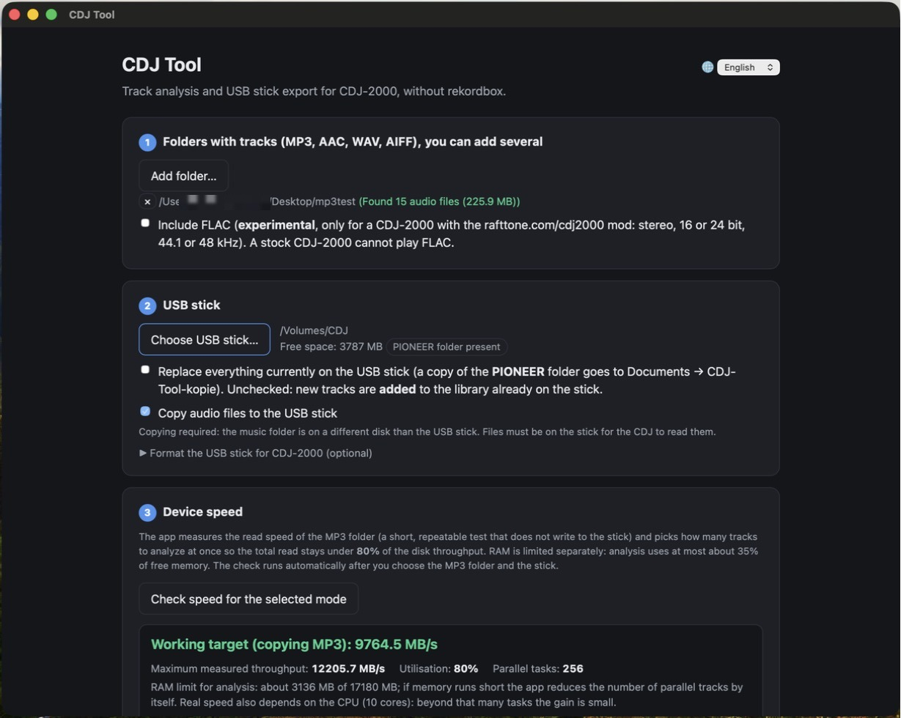
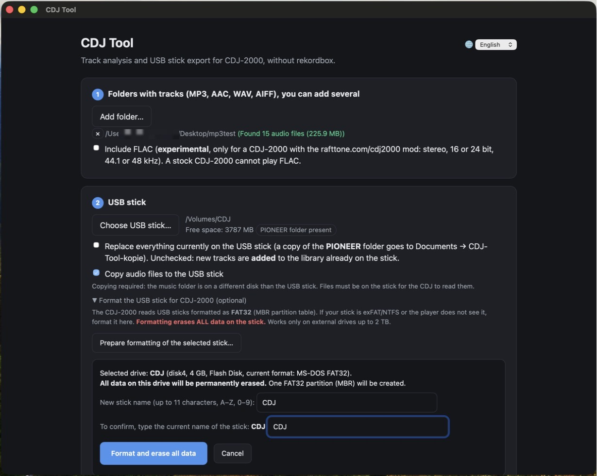
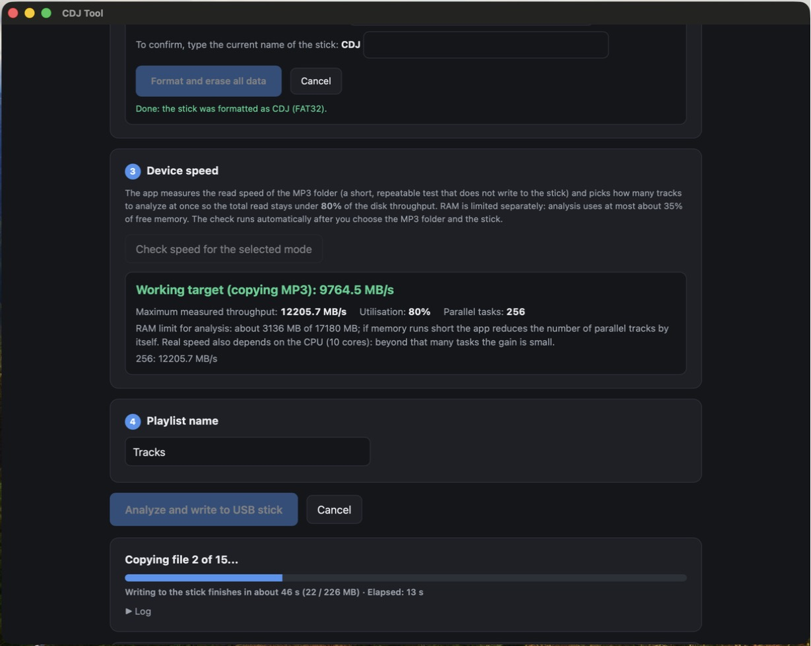
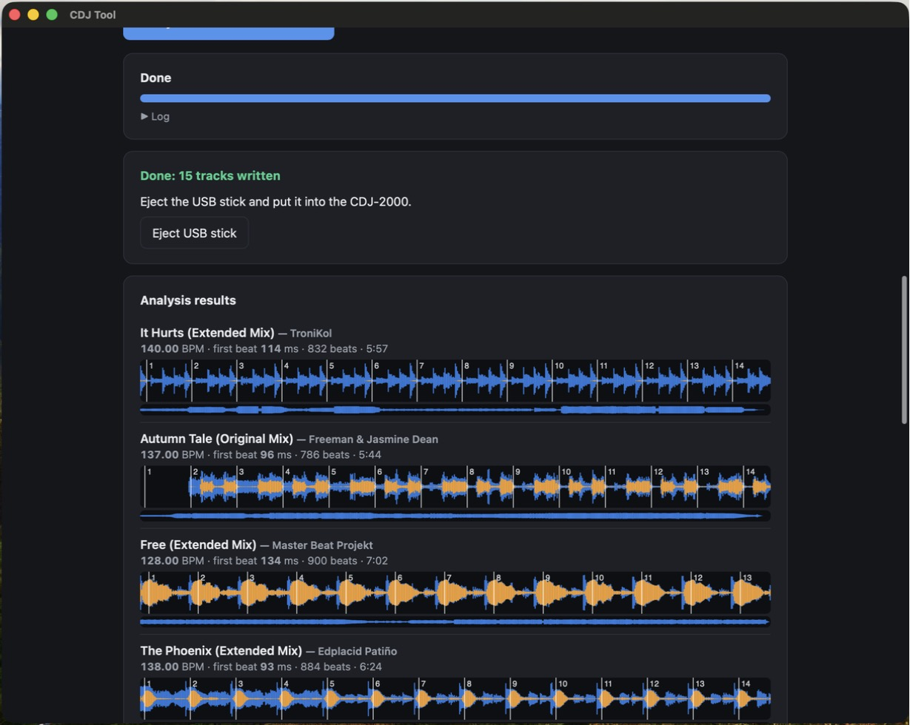

# CDJ Tool

**Prepare a USB stick for the Pioneer CDJ-2000 (the original, not NXS) on a Mac, without rekordbox. Built to work together with the [RaftTone CDJ-2000 firmware mod](https://rafttone.com/cdj2000/).**
🇵🇱 [Wersja polska](README.pl.md)

CDJ Tool analyses your tracks (BPM, beat grid, waveforms, cue points) and writes a USB stick that a **CDJ-2000**
loads like a rekordbox export: track database (`export.pdb`), analysis files (`ANLZ0000.DAT` / `.EXT`) and copies of
your audio files. It is a small native macOS app that works completely **offline**.

> **Status:** version 1.0.1. Tested by the author on real hardware: a CDJ-2000 (non-NXS) running the
> [RaftTone mod](https://rafttone.com/cdj2000/), with MP3 tracks (database, waveforms, BPM, cues, loading).
> AAC, WAV, AIFF and FLAC support is newer and still being tested on hardware; a CDJ-2000 with stock firmware has
> not been tested by the author yet (see [Known limitations](#known-limitations)). Please report what works for you.

## Screenshots

| Choose folder and stick | Format the stick (optional) |
|---|---|
|  |  |

| Analysis and copying | Results: BPM, beat grid, waveforms |
|---|---|
|  |  |

The interface is available in Polish, English, German, French, Spanish and Italian.

## Which players does it work with?

| Player | Status |
|---|---|
| **CDJ-2000 with the RaftTone mod** (official firmware 4.33 + mod) | **Main target, tested by the author** (MP3: database, waveforms, BPM, cues, loading). The mod takes waveform, beat grid and cues from the analysis files on the stick; tracks copied by hand show *NO WAVEFORM DATA*. CDJ Tool writes exactly those files. Optional FLAC (experimental, see below). |
| **CDJ-2000** (original, not NXS), stock firmware | **Intended to work** (the stick has the same structure as a rekordbox export) but **not tested by the author**. Reports welcome. |
| CDJ-2000NXS, NXS2, CDJ-900NXS2, XDJ-1000MK2 and similar | Not a target and not tested. They read the same classic database but may need extra files this tool does not write. |
| CDJ-3000X, OPUS-QUAD, OMNIS-DUO, XDJ-AZ | **Not supported.** AlphaTheta says they read only the newer *OneLibrary* format (`exportLibrary.db`), which this tool does not write. |
| CDJ-3000 | Not tested (firmware 3.30 prefers OneLibrary). |

The RaftTone mod is a separate project. CDJ Tool is independent, contains no firmware or code from it and is not
affiliated with it. Follow the mod's own page for building and flashing the firmware; do this at your own risk.

## Features

- Analysis of **MP3, AAC (.m4a), WAV and AIFF** files (the formats a stock CDJ-2000 plays; ALAC is not supported and is skipped).
- **Optional FLAC** (experimental): tick *Include FLAC* if your CDJ-2000 runs the RaftTone mod, which plays FLAC (stereo, 16 or 24 bit, 44.1 or 48 kHz). A stock CDJ-2000 cannot play FLAC.
- **BPM and beat grid** detection, **overview and detailed waveforms** (the CDJ-2000 needs the `.EXT` file to show waveforms), automatic **hot cues and memory cues**.
- **Adds to an existing library** on the stick instead of overwriting it; playlists, genres and earlier analysis are kept. Optional full replace (with a backup).
- Parallel analysis tuned to your disk speed and a RAM limit; time-remaining estimate. It uses at most half of your CPU cores, so the Mac stays cool and responsive.
- Optional **format the stick as FAT32 (MBR)** for the CDJ-2000.
- Reliable **eject** button.
- Interface in **6 languages**: Polski, English, Deutsch, Français, Español, Italiano.
- No account, no network access, no telemetry.

## Requirements

- macOS 14 (Sonoma) or newer, **Apple Silicon** (M1 or newer).
- A USB stick formatted FAT32 (the app can format it for you), and a CDJ-2000.

## Install (offline)

1. Download `CDJ-Tool-<version>.dmg` from the [Releases](../../releases) page.
2. Open it and drag **CDJ Tool** to **Applications**.
3. The first start needs one extra step because the app is not notarized by Apple (see below).

Full instructions, Gatekeeper workaround and uninstall: [docs/INSTALL.md](docs/INSTALL.md).

## Use

1. Choose the folder with your tracks and the USB stick.
2. Wait for the automatic speed check, optionally name the playlist.
3. Click **Analyze and write to USB stick**, then **Eject** and put the stick into the CDJ-2000.

By default new tracks are **added** to the library already on the stick. Tick *Replace everything* to start
from scratch (the old `PIONEER` folder is first copied to `Documents/CDJ-Tool-kopie`).

## Known limitations

- The beat grid is a constant tempo found by a kick-drum onset + tempo histogram; which beat starts the bar is voted
  with the Beat This! neural network. It is good for most four-on-the-floor tracks but **not identical to
  rekordbox**; always check the grid on the player, especially before relying on SYNC or beat jump of the mod.
- Variable-tempo tracks and tracks without a clear kick are not handled well.
- The database writer supports roughly 10,000 tracks per stick; larger sets must be split.
- Tested only on a CDJ-2000 with the RaftTone mod. See the table above for other players.
- The *Folder* browse view of a CDJ-2000 does not use the analysis data (a rekordbox export behaves the same);
  use *All Tracks* or *Playlist*.
- 24-bit WAV files saved with the `WAVE_FORMAT_EXTENSIBLE` header may not load on a CDJ-2000; use plain PCM.
- The app is ad-hoc signed, not notarized.

## How it works

The file formats were reverse-engineered by comparing exports made by rekordbox with the output of this
tool, one byte range at a time. Notes are in [docs/FORMAT.md](docs/FORMAT.md).

## Building from source

See [docs/BUILD.md](docs/BUILD.md). In short: `src/cdjtool` is a Python 3.9+ backend (NumPy, SciPy, ffmpeg)
with an HTML interface, wrapped by a small Swift launcher (`CDJToolApp.swift`).

```bash
pip install -r requirements-dev.txt
python -m pytest
```

## License in plain words

CDJ Tool is free software under the **MIT license**: anyone may use, copy, change and share it, also commercially,
as long as the copyright notice stays. The parts bundled in the app (Python, NumPy, SciPy, ONNX Runtime, the
Beat This! model, FFmpeg) have their own free licenses. All license texts are inside the app (`Licenses` folder)
and listed in [THIRD_PARTY_NOTICES.md](THIRD_PARTY_NOTICES.md). You do not need to do anything or pay for anything.

## Disclaimer

CDJ Tool is an independent, unofficial project. It is **not affiliated with, endorsed by or supported by**
Pioneer DJ, AlphaTheta, the rekordbox team or RaftTone. *Pioneer DJ*, *CDJ* and *rekordbox* are trademarks of their
respective owners and are used here only to describe compatibility. The tool writes files in a format
obtained by interoperability research; use it at your own risk and **test on a stick you can afford to wipe**.
The software is provided "as is", without warranty (see [LICENSE](LICENSE)).

## Author and credits

© 2026 **Wiktor Bakowicz**. Released under the [MIT License](LICENSE).
Bar-phase detection uses **Beat This!** (Foscarin, Schlüter, Widmer, ISMIR 2024, MIT) through ONNX Runtime.
Third-party components are listed in [THIRD_PARTY_NOTICES.md](THIRD_PARTY_NOTICES.md).
Written with the help of an AI assistant (Claude by Anthropic).
