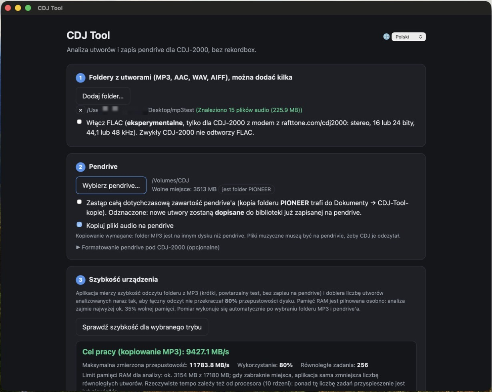
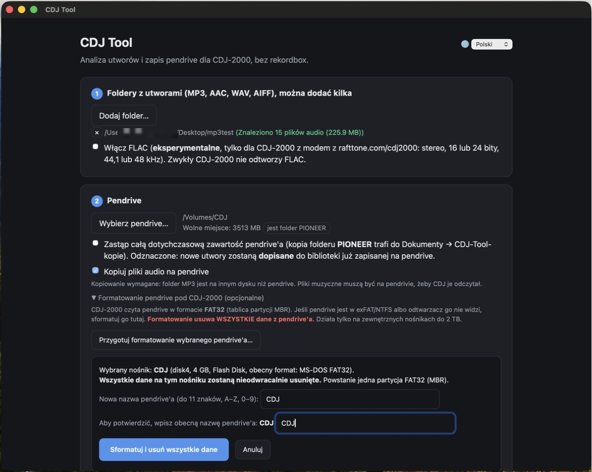
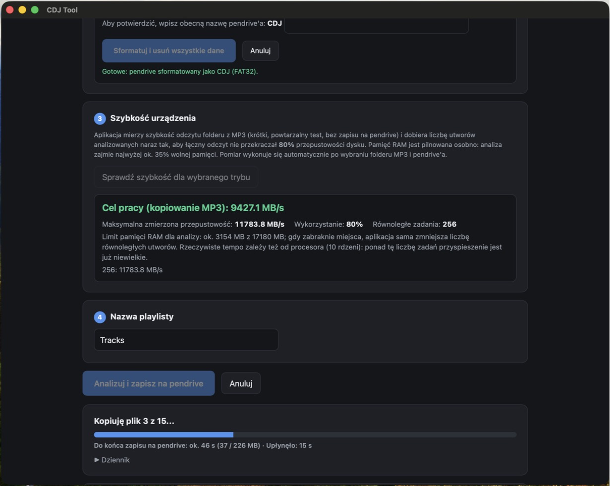
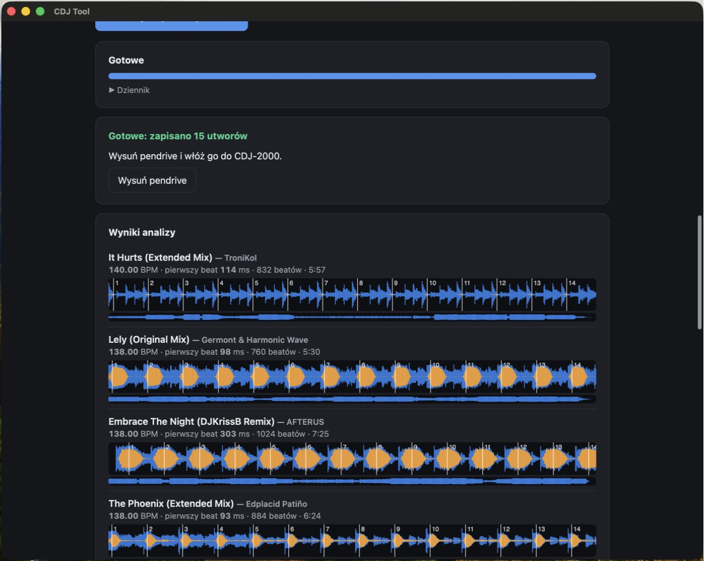

# CDJ Tool

**Przygotuj pendrive dla Pioneer CDJ-2000 (oryginalnego, nie NXS) na Macu, bez rekordboxa. Zrobiony do pracy razem z [modem firmware CDJ-2000 od RaftTone](https://rafttone.com/cdj2000/).**
🇬🇧 [English version](README.md)

CDJ Tool analizuje utwory (BPM, siatka beatów, waveformy, punkty cue) i zapisuje pendrive, który **CDJ-2000**
wczytuje tak jak eksport z rekordboxa: baza utworów (`export.pdb`), pliki analizy (`ANLZ0000.DAT` / `.EXT`)
i kopie plików audio. To mała, natywna aplikacja na macOS, która działa całkowicie **offline**.

> **Status:** wersja 1.0.3. Autor testował na prawdziwym sprzęcie: CDJ-2000 (nie NXS) z [modem RaftTone](https://rafttone.com/cdj2000/),
> na utworach MP3 (baza, waveformy, BPM, cue, wczytywanie). Obsługa AAC, WAV, AIFF i FLAC jest nowsza i nadal testowana
> na sprzęcie; CDJ-2000 z oryginalnym firmware nie był jeszcze testowany przez autora
> (zobacz [Znane ograniczenia](#znane-ograniczenia)). Daj znać, co działa u Ciebie.

## Zrzuty ekranu

| Wybór folderu i pendrive'a | Formatowanie pendrive'a (opcjonalne) |
|---|---|
|  |  |

| Analiza i kopiowanie | Wyniki: BPM, siatka beatów, waveformy |
|---|---|
|  |  |

Interfejs jest dostępny po polsku, angielsku, niemiecku, francusku, hiszpańsku i włosku.

## Z jakimi odtwarzaczami działa?

| Odtwarzacz | Status |
|---|---|
| **CDJ-2000 z modem RaftTone** (oficjalne firmware 4.33 + mod) | **Główny cel, testowany przez autora** (MP3: baza, waveformy, BPM, cue, wczytywanie). Mod bierze waveform, siatkę beatów i cue z plików analizy na pendrive; utwory skopiowane ręcznie pokazują *NO WAVEFORM DATA*. CDJ Tool zapisuje właśnie te pliki. Opcjonalny FLAC (eksperymentalny, wypada gorzej niż MP3, niżej). |
| **CDJ-2000** (oryginalny, nie NXS), oryginalne firmware | **Powinien działać** (pendrive ma tę samą strukturę co eksport z rekordboxa), ale **autor tego nie testował**. Zgłoszenia mile widziane. |
| CDJ-2000NXS, NXS2, CDJ-900NXS2, XDJ-1000MK2 i podobne | Nie są celem i nie były testowane. Czytają tę samą klasyczną bazę, ale mogą potrzebować dodatkowych plików, których narzędzie nie zapisuje. |
| CDJ-3000X, OPUS-QUAD, OMNIS-DUO, XDJ-AZ | **Nieobsługiwane.** Według AlphaTheta czytają tylko nowszy format *OneLibrary* (`exportLibrary.db`), którego to narzędzie nie zapisuje. |
| CDJ-3000 | Nietestowany (firmware 3.30 woli OneLibrary). |

Mod RaftTone to osobny projekt. CDJ Tool jest niezależny, nie zawiera firmware'u ani kodu moda i nie jest z nim
powiązany. Budowanie i wgrywanie firmware'u opisuje strona moda; robisz to na własne ryzyko.

## Funkcje

- Analiza plików **MP3, AAC (.m4a), WAV i AIFF** (formaty, które gra zwykły CDJ-2000; ALAC nie jest obsługiwany i jest pomijany).
- **Opcjonalny FLAC** (eksperymentalny): zaznacz *Włącz FLAC*, jeśli Twój CDJ-2000 ma mod RaftTone, który gra FLAC (stereo, 16 lub 24 bity, 44,1 lub 48 kHz). Zwykły CDJ-2000 nie odtworzy FLAC. W teście autora na CDJ-2000 z modem pliki FLAC się ładują i grają, ale hot cue wczytują się wolno, a odtwarzacz nie wykorzystuje wyeksportowanego BPM i siatki beatów, więc musi przeanalizować utwór sam. FLAC wypada więc gorzej niż MP3, AAC, WAV i AIFF; używaj go tylko, jeśli go potrzebujesz. Raporty z innego sprzętu są mile widziane.
- Wykrywanie **BPM i siatki beatów**, **waveform przeglądowy i szczegółowy** (CDJ-2000 potrzebuje pliku `.EXT`, żeby pokazać waveform), automatyczne **hot cue i memory cue**.
- **Dopisywanie do istniejącej biblioteki** na pendrive zamiast nadpisywania; playlisty, gatunki i wcześniejsza analiza zostają. Opcjonalne pełne zastąpienie (z kopią zapasową).
- Równoległa analiza dopasowana do szybkości dysku i limitu pamięci RAM oraz szacowany czas do końca. Używa najwyżej połowy rdzeni procesora, więc Mac pozostaje chłodny i responsywny.
- Opcjonalne **formatowanie pendrive do FAT32 (MBR)** pod CDJ-2000.
- Niezawodny przycisk **wysuwania**.
- Interfejs w **6 językach**: Polski, English, Deutsch, Français, Español, Italiano.
- Bez konta, bez dostępu do sieci, bez telemetrii.

## Wymagania

- macOS 14 (Sonoma) lub nowszy, **Apple Silicon** (M1 lub nowszy).
- Pendrive w FAT32 (aplikacja potrafi go sformatować) i CDJ-2000.

## Instalacja (offline)

1. Pobierz `CDJ-Tool-<wersja>.dmg` ze strony [Releases](../../releases).
2. Otwórz plik i przeciągnij **CDJ Tool** do **Programy** (Applications).
3. Pierwsze uruchomienie wymaga jednego dodatkowego kroku, bo aplikacja nie jest notaryzowana przez Apple (poniżej).

Pełna instrukcja, obejście Gatekeepera i odinstalowanie: [docs/INSTALL.pl.md](docs/INSTALL.pl.md).

## Użycie

1. Wybierz folder z utworami i pendrive.
2. Poczekaj na automatyczny pomiar szybkości, w razie potrzeby wpisz nazwę playlisty.
3. Kliknij **Analizuj i zapisz na pendrive**, potem **Wysuń** i włóż pendrive do CDJ-2000.

Domyślnie nowe utwory są **dopisywane** do biblioteki, która już jest na pendrive. Zaznacz
*Zastąp całą dotychczasową zawartość*, aby zacząć od zera (stary folder `PIONEER` zostanie wcześniej
skopiowany do `Dokumenty/CDJ-Tool-kopie`).

## Znane ograniczenia

- Siatka beatów to stałe tempo znalezione przez początek uderzenia stopy i histogram tempa; to, który beat otwiera
  takt, jest ustalane głosowaniem sieci neuronowej Beat This!. Dobrze radzi sobie z większością utworów
  four-on-the-floor, ale **nie jest identyczna z rekordboxem**; zawsze sprawdź ją na odtwarzaczu, zwłaszcza zanim
  zaufasz SYNC lub beat jump z moda.
- Utwory ze zmiennym tempem i bez wyraźnej stopy nie są obsługiwane dobrze.
- Zapis bazy obsługuje około 10 000 utworów na pendrive; większe zbiory trzeba podzielić.
- Testowane tylko na CDJ-2000 z modem RaftTone. Inne odtwarzacze: zobacz tabelę wyżej.
- Widok *Folder* na CDJ-2000 nie korzysta z danych analizy (eksport z rekordboxa zachowuje się tak samo);
  używaj *All Tracks* lub *Playlist*.
- 24-bitowe pliki WAV z nagłówkiem `WAVE_FORMAT_EXTENSIBLE` mogą nie wczytać się na CDJ-2000; użyj zwykłego PCM.
- Aplikacja jest podpisana ad-hoc, nie notaryzowana.

## Jak to działa

Formaty plików poznano metodą inżynierii wstecznej: eksporty z rekordboxa porównywano z wynikiem tego
narzędzia, fragment po fragmencie. Notatki: [docs/FORMAT.pl.md](docs/FORMAT.pl.md).

## Budowanie ze źródeł

Zobacz [docs/BUILD.md](docs/BUILD.md). W skrócie: `src/cdjtool` to backend w Pythonie 3.9+ (NumPy, SciPy, ffmpeg)
z interfejsem w HTML, opakowany małym launcherem w Swifcie (`CDJToolApp.swift`).

```bash
pip install -r requirements-dev.txt
python -m pytest
```

## Licencja po ludzku

CDJ Tool to wolne oprogramowanie na licencji **MIT**: każdy może go używać, kopiować, zmieniać i udostępniać, także
komercyjnie, byle zachować informację o prawach autorskich. Składniki dołączone do aplikacji (Python, NumPy, SciPy,
ONNX Runtime, model Beat This!, FFmpeg) mają własne, wolne licencje. Wszystkie teksty licencji są w aplikacji
(folder `Licenses`) i wymienione w [THIRD_PARTY_NOTICES.md](THIRD_PARTY_NOTICES.md). Nie musisz nic robić ani za nic płacić.

## Zastrzeżenie

CDJ Tool to niezależny, nieoficjalny projekt. **Nie jest powiązany z firmami Pioneer DJ, AlphaTheta ani RaftTone, ani
z zespołem rekordbox, nie jest przez nie wspierany ani zatwierdzony.** *Pioneer DJ*, *CDJ* i *rekordbox* są znakami towarowymi
ich właścicieli i występują tu wyłącznie dla opisu zgodności. Narzędzie zapisuje pliki w formacie poznanym w ramach
badań nad interoperacyjnością; używasz go na własne ryzyko, **testuj na pendrive, który możesz wyczyścić**.
Oprogramowanie jest dostarczane „tak jak jest”, bez gwarancji (zobacz [LICENSE](LICENSE)).

## Autor i podziękowania

© 2026 **Wiktor Bakowicz**. Licencja [MIT](LICENSE).
Wykrywanie fazy taktu korzysta z **Beat This!** (Foscarin, Schlüter, Widmer, ISMIR 2024, MIT) przez ONNX Runtime.
Składniki osób trzecich: [THIRD_PARTY_NOTICES.md](THIRD_PARTY_NOTICES.md).
Powstało z pomocą asystenta AI (Claude, Anthropic).
